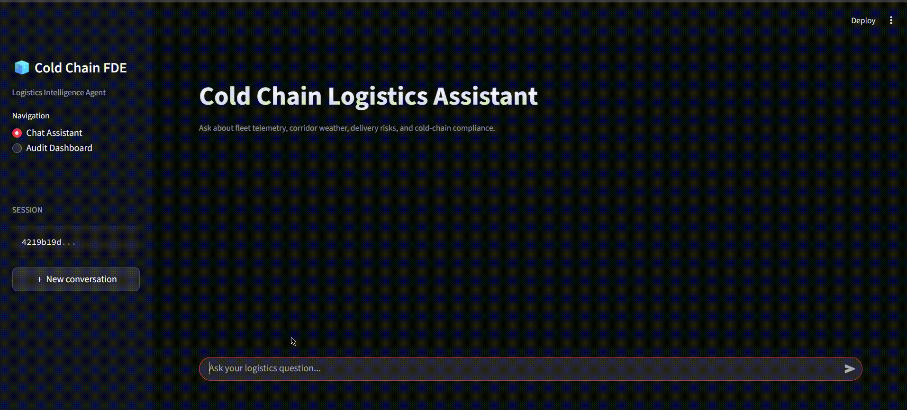
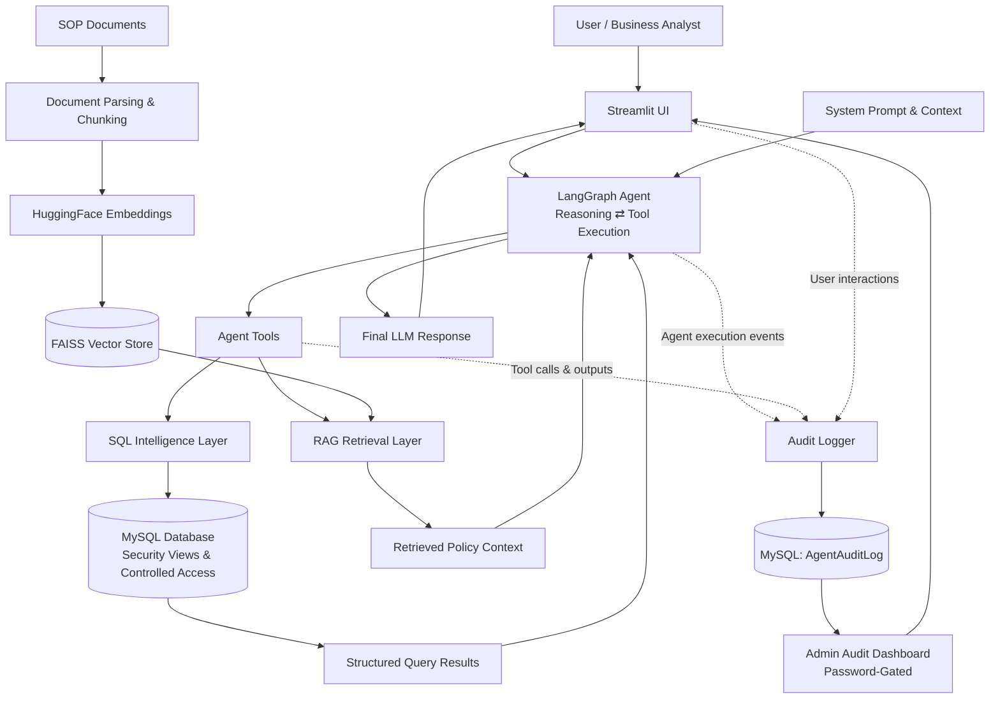

# ❄️ ColdChain Intelligence

### An intelligent AI-powered data assistant that transforms natural-language questions into actionable insights using autonomous agents, SQL, and RAG.


**Natural-language-to-SQL · RAG over SOPs · Tool-calling agent · Incremental vector indexing · Guarded DB access · Admin-gated audit dashboard**

---

Cold-chain operations (vaccines, pharma, dairy, perishables) depend on two very different knowledge sources: **structured data** (deliveries, inventory, delays in a SQL database) and **unstructured policy** (SOPs, compliance and handling procedures in PDFs and spreadsheets). Answering one operational question often means checking both.

**ColdChain Intelligence** puts an LLM agent in front of both. The agent decides per question whether to query the database, retrieve the relevant SOP passage, or combine the two, and returns one grounded answer through a chat UI. Because an LLM is generating queries against business data, every agent step is recorded in an **audit log** that only authenticated admins can inspect.

> *"Are there any shipments that violate SOP temperature requirements but are not classified as High Risk?"*
> One question. SQL for the first half, RAG for the second, one answer, and a traceable record of how it got there.

---

##  Demo



---

##  What it does

| Capability | Details |
|---|---|
| **Natural language → SQL** | Business questions become queries against a MySQL logistics database; results feed back into the answer. |
| **RAG over SOPs** | Semantic search across PDF, Markdown, TXT, CSV and XLSX policy documents with source-level metadata. |
| **Agent orchestration** | A LangGraph agent loops between a reasoning node and a tools node, routing to SQL or retrieval tools, guided by a dedicated system prompt. |
| **Transparent reasoning** | The chat UI streams agent progress and shows each tool call's input and output in expandable panels. |
| **Audit logging** | Every tool call (with arguments), tool output and final response is written to a MySQL audit table, keyed by session ID. |
| **Admin audit dashboard** | A password-protected Streamlit page to filter by session, view activity metrics, and inspect individual events. |
| **Guarded DB access** | The application reaches data through restricted views and a dedicated access layer, with separate credentials for the agent, audit writes and audit reads. |
| **Incremental ingestion** | SHA-256 change detection re-embeds only new or modified documents and removes vectors for deleted ones. |

---

##  Architecture



### Layers

| Layer | Technology | Responsibility |
|---|---|---|
| Presentation | Streamlit | Chat interface, agent trace, audit dashboard |
| Orchestration | LangGraph | Stateful agent workflow with per-session threads |
| Reasoning | LLM + system prompt | Intent interpretation and answer generation |
| Structured data | MySQL, SQLAlchemy | Logistics records via restricted views |
| Unstructured data | PyPDF, Pandas, LangChain splitters | Multi-format document parsing and chunking |
| Retrieval | `all-MiniLM-L6-v2`, FAISS | Embedding and similarity search |
| Governance | MySQL audit table, admin gate | Traceability and restricted access to agent activity |

---

## Engineering decisions 

**1. Auditability for LLM-generated SQL.**
When a model writes queries against business data, you need to be able to answer "what did it run, and what came back?" Each agent event is stored with its session ID, the node that produced it (`reasoner` or `tools`), the tool name, and the content (JSON tool arguments, tool output, or the final answer, capped at 60k characters). The audit writer is non-blocking: a logging failure is reported to the console but never prevents the agent from answering.

**2. Separation of duties on database credentials.**
The agent/audit-writer account and the dashboard's read account are configured separately (`AGENT_DB_*` vs `AUDIT_DB_*`), so the dashboard can run on a read-only user. Audit access to the UI is behind an admin password checked with a constant-time comparison (`hmac.compare_digest`), and credentials live in environment variables, never in code.

**3. Incremental vector indexing instead of full rebuilds.**
Each source file gets a stable ID and a SHA-256 content hash stored in a persistent JSON cache. On each run the pipeline classifies files as *new*, *modified*, *deleted* or *unchanged*, so only the first three touch the index. Deleted documents have their vectors removed, which prevents stale policy text from being retrieved.

**4. Retrieval that keeps its provenance.**
Every chunk carries metadata (source file, page number, row number, section heading), so an answer can be traced back to the exact SOP location.

**5. Format-aware chunking.**
Markdown is split by header structure first, then by recursive character splitting (600-char chunks, 80-char overlap), so sections stay coherent. Tabular sources (CSV/XLSX) are handled by row.

**6. Least-privilege data access.**
`security_and_view.sql` defines views and permissions so the agent queries a constrained surface, not the full schema. Database code is kept separate from agent logic, which keeps the SQL tool auditable.

**7. Modular separation.**
UI, orchestration, tools, DB access and ingestion are independent modules. Adding a new tool (e.g. an anomaly detector) means registering it, not restructuring the agent.

---

##  Tech stack

- **Language:** Python, SQL
- **GenAI / Agents:** LLMs, LangGraph, LangChain, tool calling, prompt engineering
- **RAG:** HuggingFace Sentence Transformers (`all-MiniLM-L6-v2`, 384-dim), FAISS, recursive and Markdown-header chunking
- **Data:** MySQL, SQLAlchemy (PyMySQL), Pandas, PyPDF, openpyxl
- **App:** Streamlit
- **Config & security:** `.env`-based configuration, role-separated DB credentials, admin-gated audit access, Git

---

##  Project structure

```text
Cold-chain-logistics-AI/
├── data/
│   ├── cache/            # ingestion_hash_cache.json (change-detection state)
│   ├── policy/           # SOP & compliance documents
│   ├── raw/              # raw logistics datasets
│   └── vectorstore/
│       └── sop_faiss/    # persisted FAISS index
├── docs/                 # project documentation
├── Misc/Materials/       # supporting resources
├── scripts/ingest/
│   ├── ingest_legacy_data.py   # load raw logistics data into MySQL
│   ├── ingest_sop_faiss.py     # SOP parse → chunk → embed → index
│   └── security_and_view.sql   # DB views and permissions
├── src/
│   ├── prompts/system_prompt.txt
│   ├── agent_tools.py    # SQL + retrieval tools exposed to the agent
│   ├── db.py             # MySQL connectivity
│   ├── orchestrator.py   # LangGraph agent workflow
│   └── ui.py             # Streamlit chat, audit logging, admin dashboard
├── requirements.txt
└── README.md
```

---

##  Getting started

**Prerequisites:** Python 3.10+, MySQL Server, Git, and an API key for your LLM provider.

```bash
# 1. Clone
git clone https://github.com/DipanshuK04/Cold-chain-logistics-AI.git
cd Cold-chain-logistics-AI

# 2. Virtual environment
python -m venv venv
source venv/bin/activate        # Windows: venv\Scripts\activate

# 3. Dependencies
pip install -r requirements.txt
```

**4. Configure `.env`** (match the variable names used in `db.py`, `orchestrator.py` and `ui.py`):

```env
# Database (data access)
DB_HOST=localhost
DB_PORT=3306
DB_NAME=your_database_name
DB_USER=your_database_user
DB_PASSWORD=your_database_password

# Agent DB account (also used by the UI to write audit events)
AGENT_DB_HOST=localhost
AGENT_DB_PORT=3306
AGENT_DB_NAME=your_database_name
AGENT_DB_USER=agent_user
AGENT_DB_PASSWORD=agent_password

# Audit read-only account (used by the dashboard)
AUDIT_DB_HOST=localhost
AUDIT_DB_PORT=3306
AUDIT_DB_USER=audit_reader
AUDIT_DB_PASSWORD=audit_reader_password

# Admin password for the Audit Dashboard
AUDIT_ADMIN_PASSWORD=choose_a_strong_password

# LLM
GROQ_API_KEY=your_api_key
```


**5. Set up the database:** create the database, load the logistics data (`scripts/ingest/ingest_legacy_data.py`), then apply `scripts/ingest/security_and_view.sql`. Make sure the `fde_views.AgentAuditLog` table exists, with `INSERT` granted to the agent account and `SELECT` only to the audit reader.

**6. Index your SOPs:** place documents in `data/policy/`, then run:

```bash
python -m scripts.ingest.ingest_sop_faiss
```

Re-running only processes files that changed.

**7. Launch:**

```bash
streamlit run src/ui.py
```

Use **Chat Assistant** for questions and **Audit Dashboard** (admin password required) to review agent activity.

---

## 🛡️ Audit logging & admin dashboard

| What is recorded | Where |
|---|---|
| Session ID (one per conversation thread) | `fde_views.AgentAuditLog.SessionID` |
| Node that produced the event (`reasoner` / `tools`) | `NodeExecuted` |
| Tool name, or `Final response` | `ToolName` |
| Tool arguments (JSON), tool output, or final answer | `Content` (truncated at 60,000 chars) |


**Access control:** the dashboard is hidden behind an admin login (password from `AUDIT_ADMIN_PASSWORD`, constant-time comparison) with logout, and reads through a separate database account.


---

##  Example questions

| Area | Question |
|---|---|
| Delivery analytics | Which deliveries experienced the highest delays? |
| Inventory | What is the current warehouse inventory position? |
| Compliance | What are the prescribed temperature-handling procedures? |
| SOP guidance | What should be done when cargo temperature exceeds permitted limits? |
| Risk | Which indicators should I investigate when a shipment is delayed? |
| **Hybrid** | Which shipments were delayed, and what does the SOP require for each case? |

---


---


[LinkedIn](https://www.linkedin.com/in/dipanshu-katole-95200b27b/)

---

*An applied AI engineering project bridging enterprise data systems, intelligent agents and retrieval-augmented generation.*
